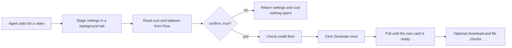

<div align="center">

# 🎬 Google Flow Browser MCP

**Drive [Google Flow](https://flow.google.com/) image and video generation from your AI agent, with your own Google account.**

<p>
  
  = 18">
  
  
  
  
</p>

<br>

[✨ Features](#-features) •
[🚀 Quick Start](#-quick-start) •
[🔧 Tools](#-tools) •
[💳 Credits & Jobs](#-credits--jobs) •
[⚙️ Configuration](#️-configuration) •
[🛡️ Safety](#️-safety) •
[🇰🇷 한국어](#-한국어-안내)

<br>

</div>

---

> **Fork notice:** this is a fork of [TMSSS05/google-flow-browser-mcp](https://github.com/TMSSS05/google-flow-browser-mcp), rebuilt while making a real 30-cut music video. Credit for the original design belongs to TMSSS05. Both the original and the fork are covered by the [MIT license](LICENSE).

---

## 📸 What It Does

This MCP server connects Claude Code, Claude Desktop, Cursor or any other MCP client to **Google Flow** through a real Chrome, Chromium or Edge window. Your agent can:

- 🎨 **Generate images** with Flow's image models (Nano Banana 2.1 in November 2026)
- 🎬 **Generate videos** from text, start/end frames or reference ingredients (Omni 1.2 Flash, Omni 1.1 Flash, Veo 3.1)
- 🗂️ **Manage projects and assets**: list, open, upload, rename, trash and restore
- ⬇️ **Download and upscale** to 1080p or 4K with file checks
- 🧑 **Stage characters, scenes and Grid Architect** jobs
- 🔍 **Inspect any Flow page** when the UI changes

No API key, no copied browser profile and no config file. You sign in once by hand in a dedicated profile.

---

## ✨ Features

<table>
<tr>
  <td width="50%">

### 🤖 For AI agents
  </td>
  <td width="50%">

### 🙋 For humans
  </td>
</tr>
<tr>
  <td>

- **30 MCP tools** with JSON schemas
- **Dry run by default**: settings and cost come back before anything is spent
- **Persistent job queue** that resumes after a restart without clicking Generate twice
- **Fails closed** when the UI looks different instead of guessing
- **Korean UI field-tested**, with English, French and Japanese labels
  </td>
  <td>

- **Your account, your browser**: no password ever typed by the server
- **Works in a background tab**, so your window and focus stay yours
- **Credit floor** and explicit `confirm: true` for every paid action
- **4K only after 1080p is approved**, never chained
- **No telemetry**, no permanent delete tool, watermark kept
  </td>
</tr>
</table>

---

## 🚀 Quick Start

### Prerequisites

| What | Why |
|------|-----|
| **Node.js ≥ 18** | Runs the MCP server |
| **Chrome, Chromium or Edge** | The system browser is used; nothing is downloaded |
| **An MCP client** | Claude Code, Claude Desktop, Cursor and others |
| **A Google account with Flow access** | Plans and credits come from Google |

### 1️⃣ Add the server

```sh
claude mcp add google-flow -- npx -y github:yong6330/google-flow-browser-mcp
```

<details>
<summary><strong>Claude Desktop or Cursor</strong></summary>

Merge this into the existing `mcpServers` object:

```json
{
  "mcpServers": {
    "google-flow": {
      "command": "npx",
      "args": ["-y", "github:yong6330/google-flow-browser-mcp"]
    }
  }
}
```

On Windows, clients that cannot spawn `npx` directly can use `"command": "cmd"` with `"args": ["/c", "npx", "-y", "github:yong6330/google-flow-browser-mcp"]`.
</details>

### 2️⃣ Sign in once

Restart the client and ask it to call `flow_connect`. A dedicated browser window opens. Sign in there by hand, then call `flow_connect` again.

### 3️⃣ Try a dry run

```text
List my Flow projects, open one, and stage an 8 second Omni 1.2 Flash video
of a ceramic cup on a wooden table. Show me the cost before spending anything.
```

The agent gets the staged settings and the credit cost back. Nothing is spent until you say yes and it sends `confirm: true`.

<details>
<summary><strong>Run from a local checkout</strong></summary>

```sh
git clone https://github.com/yong6330/google-flow-browser-mcp.git
cd google-flow-browser-mcp
npm install
npm test
npm run doctor
npm start
```

`npm start` speaks MCP on stdout and logs to stderr. It does not open a browser until a tool asks for one. `npm run doctor` works without signing in.
</details>

---

## 🔄 How a Paid Job Flows



---

## 🔧 Tools

Every tool validates its arguments and publishes a JSON schema through MCP `tools/list`. Assets can be matched by `key`, by exact `caption` plus `prompt`, or by inventory `index`. Cards that cannot be told apart are refused.

### 🌐 Connection & Status

| Tool | What it does |
|------|-------------|
| `flow_connect` / `flow_disconnect` | Launch or attach the dedicated browser. Disconnect closes only the server's own tab |
| `flow_status` | Connection and persisted job state, without opening a browser |
| `flow_doctor` | Node, browser path, profile, CDP, login, language and credits |
| `flow_account_check` / `flow_credits` | Signed-in email and credit balance from the account panel |
| `flow_screenshot` | On-demand screenshot with a short timeout and CDP fallback |

### 🗂️ Projects & Assets

| Tool | What it does |
|------|-------------|
| `flow_projects` | `action: list \| open \| create` by `name` or `id` |
| `flow_list_assets` | Scans the virtual grid, including both trash columns |
| `flow_upload_media` | Uploads absolute `paths[]`, skips duplicates by file name |
| `flow_rename_asset` | Renames only after the opened caption field is verified |
| `flow_trash_assets` / `flow_restore_assets` | Dry run unless `confirm: true`. There is no permanent delete |

### 🎨 Generation

| Tool | What it does |
|------|-------------|
| `flow_generate_image` | `prompt`, `model`, `ratio`, `quantity` 1–4, `reference_images[]` |
| `flow_generate_video` | `prompt`, `mode: text \| frames \| ingredients`, `start_image`, `end_image` or `reference_images[]`, plus `ratio` and `quantity` |

For video, `model`, `duration` and `resolution` are optional. Leave them out to keep what Flow already has selected. Name the model as Flow shows it, for example `Omni 1.2 Flash`. `Veo 3.1 Fast` also finds `Veo 3.1 - Fast`. Veo 3.1 has no resolution or length setting.

### ⬇️ Download & Upscale

| Tool | What it does |
|------|-------------|
| `flow_download_asset` | `quality: 270p-gif \| 720p \| 1080p` into your output folder |
| `flow_upscale_download` | Batch 1080p or 4K with `confirm`, `allow_4k` and optional `compare_with` |
| `flow_download_latest` | Compatibility alias for the newest asset |

### 📊 Jobs & Housekeeping

| Tool | What it does |
|------|-------------|
| `flow_job_status` / `flow_job_cancel` | Follow or stop a job by `job_id`. Cancel stops local work only |
| `flow_queue_status` | Recent persisted jobs |
| `flow_cleanup` | Removes old logs, screenshots and temp files. Dry run unless `confirm: true` |

### 🧑 Characters, Scenes & Tools

| Tool | What it does |
|------|-------------|
| `flow_create_character` / `flow_import_character` / `flow_open_characters` | Stage a character, import JSON, inspect the section |
| `flow_create_scene` | Stage a `prompt` with optional `characters[]` |
| `flow_open_tools_gallery` / `flow_use_tool` | Inspect the gallery or open a tool by exact name |
| `flow_use_grid_architect` | Stage theme, shot prompts, engine, ratio and references |
| `flow_discover_ui` | List the controls on the current page |

Generation tools accept `project_id` or `project_name`. Otherwise open a project first.

---

## 💳 Credits & Jobs

| Rule | Detail |
|------|--------|
| **Dry run by default** | Image, video and upscale stage settings and return Flow's own cost line |
| **Explicit spend** | Only `confirm: true` clicks a paid button. Unverifiable cost, balance or settings stop the job |
| **Credit floor** | `creditFloor` keeps a minimum balance. Uncertain jobs keep their reservation |
| **One click per job** | A write-ahead intent is saved before the click. After a restart the job resumes polling and never clicks again |
| **Duplicate guard** | The same project, prompt, frames and settings reuse a job for 24 hours. `force: true` bypasses it on purpose |
| **Parallelism** | One job by default, three at most. Batch upscale drops to one after an error |
| **4K** | Needs `confirm: true` and `allow_4k: true`, and only after you approved the 1080p result |

Downloads keep Flow's sparkle watermark. ZIP files keep Unicode names. SHA-256 and size are always reported. With `ffprobe` installed, codec, size, duration and resolution are checked too. `compare_with` adds an `ffmpeg` SSIM similarity check.

---

## ⚙️ Configuration

Everything is optional. Precedence is tool argument, then `FLOW_MCP_*` environment variable, then the user config file, then the default.

| Platform | Config file |
|----------|-------------|
| macOS | `~/Library/Application Support/google-flow-mcp/config.json` |
| Windows | `%APPDATA%\google-flow-mcp\config.json` |
| Linux | `$XDG_CONFIG_HOME/google-flow-mcp/config.json` or `~/.config/google-flow-mcp/config.json` |

`FLOW_MCP_CONFIG` points somewhere else. See [config/flow.config.example.json](config/flow.config.example.json).

<details>
<summary><strong>All options</strong></summary>

| Key | Environment variable | Default |
|-----|---------------------|---------|
| `home` | `FLOW_MCP_HOME` | `~/.google-flow-mcp` |
| `chromePath` | `FLOW_MCP_CHROME_PATH` | Found automatically |
| `flowUrl` | `FLOW_MCP_FLOW_URL` | `https://flow.google.com/` |
| `expectedAccount` | `FLOW_MCP_EXPECTED_ACCOUNT` | Unset. When set, the signed-in email must match |
| `cdpPort` | `FLOW_MCP_CDP_PORT` | `9222`, or the next free port |
| `headless` | `FLOW_MCP_HEADLESS` | `false` so you can sign in |
| `maxConcurrentJobs` | `FLOW_MCP_MAX_CONCURRENT_JOBS` | `1` (allowed 1–3) |
| `creditFloor` | `FLOW_MCP_CREDIT_FLOOR` | `0` |
| `jobTimeoutMs` | `FLOW_MCP_JOB_TIMEOUT_MS` | `600000` |
| `pollIntervalMs` | `FLOW_MCP_POLL_INTERVAL_MS` | `5000` |
| `downloadWaitMs` | `FLOW_MCP_DOWNLOAD_WAIT_MS` | `300000` |
| `idempotencyWindowMs` | `FLOW_MCP_IDEMPOTENCY_WINDOW_MS` | `86400000` (24 hours) |
| `uiStrings` | `FLOW_MCP_UI_STRINGS` | `{}` extra UI labels per language, as JSON |

Boolean environment values must be `true` or `false`. Unknown keys warn and invalid values stop startup.
</details>

### 📁 Where files go

```
~/.google-flow-mcp/
├── profile/       dedicated browser profile (never your regular one)
├── outputs/       downloads, unless you pass an absolute output_folder
├── state/         job queue and duplicate protection
├── logs/
├── screenshots/   only when you ask for one
└── temp/
```

Nothing is written to the current directory or your Downloads folder. Run one server per home. Two clients need two homes and two sign-ins.

---

## 🌍 Languages

| Language | Status |
|----------|--------|
| 🇰🇷 Korean (`ko`) | Field-tested in November 2026 ([UI notes](docs/FLOW_UI_NOTES.md)) |
| 🇺🇸 English (`en`) | Best effort |
| 🇫🇷 French (`fr`) | Best effort |
| 🇯🇵 Japanese (`ja`) | Best effort |

Controls are found by role, aria label and icon first, then by the detected language's labels. Other languages can add labels through `uiStrings` without code changes.

---

## 🛡️ Safety

| ✅ Principle | How it is enforced |
|-------------|-------------------|
| **Your account only** | A dedicated profile you sign into yourself. Your regular profile is never read or copied |
| **No credentials** | The server never types passwords and stops on any login or verification screen |
| **Your screen stays yours** | Automation runs in a background tab and never brings a tab to the front |
| **No surprise spending** | Dry run first, explicit confirm, credit floor, one click per job |
| **Nothing permanent** | Trash and restore only. The trash is never emptied |
| **Provenance kept** | Flow's watermark is never removed or covered |

> ⚠️ Use only an account you are allowed to operate and follow Google's terms. You are responsible for prompts, generated content and credit spending.

---

## ❓ FAQ & Troubleshooting

<details>
<summary><strong>Chrome crashes on start with a Crashpad or sandbox error</strong></summary>

Run `node scripts/start-browser.mjs` from a normal terminal, sign in, then call `flow_connect` to attach. Do not weaken browser security or use your regular profile.
</details>

<details>
<summary><strong>Port 9222 is already in use</strong></summary>

Unrelated processes are never killed or attached. The launcher picks another free port and reuses only the dedicated profile's own CDP marker.
</details>

<details>
<summary><strong>"Another MCP server owns this data directory"</strong></summary>

One server already runs for that home, often from another client session. Close it, or give the second client its own `FLOW_MCP_HOME`.
</details>

<details>
<summary><strong>"UI changed: … matched 0 elements"</strong></summary>

Flow moved a control. Call `flow_discover_ui`, compare the labels, and add them through `uiStrings` if your language differs. Paid clicks stop until every setting can be verified.
</details>

<details>
<summary><strong>A download is missing after a restart</strong></summary>

Download events do not survive a process restart. The job waits without clicking the paid option again. Download the card by hand if nothing arrives.
</details>

<details>
<summary><strong>How do I test against my live account without spending?</strong></summary>

```sh
node scripts/live-smoke.mjs
node scripts/live-smoke.mjs --project PROJECT_ID --prompt "A ceramic cup"
# Only after you reviewed the staged settings and cost:
node scripts/live-smoke.mjs --project PROJECT_ID --prompt "A ceramic cup" --spend --download
```

The default run never spends credits. The [live checklist](docs/ARCHITECTURE.md#live-verification-checklist) shows what has been verified so far.
</details>

---

## 🇰🇷 한국어 안내

Node.js 18 이상과 Chrome 또는 Chromium 또는 Edge가 필요합니다.

1. `claude mcp add google-flow -- npx -y github:yong6330/google-flow-browser-mcp` 로 서버를 추가합니다.
2. `flow_connect` 를 부르면 전용 브라우저 창이 열립니다. 처음 한 번만 직접 로그인하세요.
3. 생성과 업스케일은 기본이 시험 실행입니다. 설정과 크레딧 비용을 먼저 보여 주고 `confirm: true` 를 받아야 실제로 씁니다.
4. 4K는 1080p 결과를 확인하고 승인한 뒤에만 `allow_4k: true` 로 진행합니다.

일반 Chrome 프로필은 읽거나 복사하지 않습니다. 자동화는 뒤쪽 탭에서만 돌기 때문에 쓰고 계신 창을 가져가지 않습니다. 한국어 화면은 2026년 11월 실제 계정에서 시험 실행으로 확인했습니다.

---

## 🎞️ Companion Skill

**[google-flow-ai-video-production-skill](https://github.com/yong6330/google-flow-ai-video-production-skill)** is a Claude Code skill for the whole AI video workflow on top of this server. It covers the cut sheet, base images, start/end-frame generation, frame-by-frame QA, upscale and a beat-synced Python + FFmpeg edit. A copy also ships in [`skills/ai-video-production/`](skills/ai-video-production/).

---

## 📚 More

- [Changelog](CHANGELOG.md)
- [Architecture and live checklist](docs/ARCHITECTURE.md)
- [Flow UI notes](docs/FLOW_UI_NOTES.md)

## 📄 License

[MIT](LICENSE). Original work © [TMSSS05](https://github.com/TMSSS05/google-flow-browser-mcp). Modifications © yong6330.

---

<div align="center">
  <sub>Built while making a real AI music video 🎵</sub>
  <br>
  <sub>
    <a href="https://github.com/yong6330/google-flow-browser-mcp/issues">Report an issue</a> ·
    <a href="https://github.com/yong6330/google-flow-ai-video-production-skill">Companion skill</a>
  </sub>
</div>
